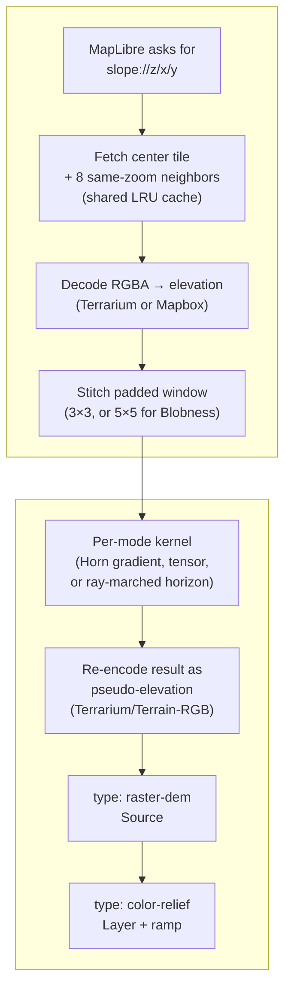

This page covers the mechanism — how a `*-protocol.ts` file gets from an upstream raster-dem tile to a rendered layer. For what each mode *means* geomorphologically, see [Terrain Visualization Modes](/features/visualization-modes); for the exact formulas, see [Equations & Formulas](/dev/equations).

Slope is the reference implementation, but the same pipeline shape covers Aspect, Curvature (and its Profile/Plan/Det-Hessian/Casorati/Shape-Index sub-modes), TRI, TPI, Roughness, Blobness (and its Eigen-Ratio/Orientation sub-modes), Sky-View Factor, Openness, and Local Dominance — eleven modes, three files' worth of shared plumbing, one formula each. LRM and the Lighting Effects modes (Matcap/Phong/Hard Shadows) genuinely diverge — see [LRM](/dev/lrm) and [Lighting Effects](/dev/lighting-effects).


<p className="text-sm text-fd-muted-foreground italic">Slope + Hillshade backdrop — Matterhorn massif — <a href="https://terrain-viewer.iconem.com/?lat=45.9763&lng=7.6586&zoom=12.6&pitch=0&bearing=0&viewMode=3d&showHillshade=true&showTerrainAnalysis=true&showSlope=true&hillshadeOpacity=0.5&slopeMaxDegrees=84&exaggeration=1" target="_blank" rel="noopener noreferrer">open in app ↗</a></p>



## 1. Source fetch

Each mode is a MapLibre [custom protocol](https://maplibre.org/maplibre-gl-js/docs/API/functions/addProtocol/) (`slope://`, `aspect://`, `curvature://`, `tri://`, `tpi://`, `roughness://`, `blobness://`, `svf://`, `openness://`, `local-dominance://`) whose tile URL embeds the *upstream* raster-dem tile template plus `{z}/{x}/{y}`. On a tile request, the handler fetches the center tile **and its 8 same-zoom neighbors** concurrently — needed so the kernel at a tile's edge pixels has real neighbor data rather than a clamped repeat. All of them (and Slope, Aspect, TRI, Curvature, TPI, Roughness, Normals, Matcap, Phong specifically) share one LRU `sharedTileCache`, so turning on several derived layers at once still decodes each upstream tile exactly once.

## 2. Decoding elevation

Each fetched tile's RGBA is decoded to a `Float32Array` using the upstream's encoding — either [Terrarium](https://www.mapzen.com/blog/elevation/) or Mapbox Terrain-RGB (`lib/elevation-encoding.ts`):

$$
h_{\text{terrarium}} = \left(R \cdot 256 + G + \frac{B}{256}\right) - 32768
$$

$$
h_{\text{mapbox}} = -10000 + (R \cdot 256^2 + G \cdot 256 + B) \cdot 0.1
$$

## 3. Stitching a padded neighborhood grid

The 9 decoded tiles are stitched into one padded `(n + 2·halo) × (n + 2·halo)` grid, edge-replicated where a neighbor is missing (world edges, poles, a failed fetch). Most modes use `halo = 1` — a plain 3×3 window (`a0..a8`, GDAL's row-major convention). Blobness uses `halo = 2` (5×5) because its structure tensor needs a Horn gradient computed *at each of the 9 sub-cells* around the output pixel, not just once at the center. SVF/Openness/Local Dominance instead march rays outward up to a user-set search radius (see below), so their halo is that radius, not a fixed 1 or 2.

## 4. The kernel

- **Slope, Aspect, TRI, TPI, Roughness, Curvature** all reuse the same Horn 3×3 gradient (`hornGradient()` in `lib/normal-derived-protocol.ts`, ported from GDAL's `GDALSlopeHornAlg`), Mercator-corrected by `cos(tileCenterLat)` so the ground-distance denominator is real, not the nominal equator-only pixel size.
- **Blobness / Eigen-Ratio / Orientation** build a Förstner/Harris structure tensor from 9 Horn gradients (one per sub-cell of the 3×3 window) and read off `det/trace`, the eigenvalue ratio, or the principal eigenvector's axis.
- **SVF / Openness / Local Dominance** march outward in 8 compass directions (`lib/horizon-angle.ts`) rather than sampling a fixed-size window — see that file's own precision/performance tradeoffs (fixed 8 directions, integer-pixel steps, an optional "fast" power-of-two-radius approximation).

The exact per-mode formulas are on the [Equations page](/dev/equations); this page is about what happens to the result once it's computed.

## 5. Output encoding — the key architectural trick

The computed scalar is **not** rendered directly to RGBA color. It's re-packed as a *pseudo-elevation*, using the exact same byte-packing MapLibre's native `raster-dem` decoder already knows how to read:

```ts
// lib/tri-protocol.ts (representative — every mode in this family ends the same way)
const [r, g, b, alpha] = elevationToTerrarium(computeValue(window))
outData[idx] = r; outData[idx + 1] = g; outData[idx + 2] = b; outData[idx + 3] = alpha
```

Slope uses Mapbox Terrain-RGB packing (base −10000, 0.1 unit step — plenty of precision for a 0–90° angle); every other mode uses Terrarium packing (~0.0039 step) because their values cluster near zero and would visibly band under Terrain-RGB's coarser step. Curvature additionally multiplies by an internal `CURVATURE_ENCODE_SCALE = 1000` before encoding (undone when the raw value is read back for the UI/ramp bounds) purely to spread its small, near-zero-heavy range across more of Terrarium's discrete levels.

Those packed bytes are then handed to maplibre as an **`ImageBitmap`**, via the shared `toTileImage` tail in `lib/tile-image.ts` — *not* PNG-encoded. That choice is worth three orders of magnitude per tile and is the subject of [the last section on this page](#handing-the-tile-back-to-maplibre).

## 6. MapLibre consumption

The resulting bitmap is added as an ordinary `type: "raster-dem"` `<Source>` — e.g. `SlopeSource` in `components/LayersAndSources/MapSources.tsx`:

```tsx
<Source id="slopeSource" type="raster-dem" tiles={[url]} tileSize={256} encoding="mapbox" />
```

A `type="color-relief"` `<Layer>` (`SlopeReliefLayer` and its siblings in `MapLayers.tsx`) then reads that source through MapLibre's native `["elevation"]` expression and a `color-relief-color` interpolate expression built from a ramp in `lib/color-ramps.ts` (`slope-plantopo`, `tri-default`, `curvature-diverging`, `blobness-default`, …):

```tsx
<Layer id="color-relief" type="color-relief" source="hillshadeSource" paint={colorReliefPaint} />
```

So: **the derivative value is smuggled through the raster-dem pixel format, and MapLibre's own color-relief machinery does the decode-and-color step.** None of these protocol handlers hand-roll an RGBA colormap themselves — the same `computeColorReliefPaint` helper that colors real hypsometric elevation tint also colors slope degrees, curvature, TRI, and every other mode here, because to MapLibre they're indistinguishable from elevation.

## 7. Registration

Every protocol is registered once, at app init, in `components/TerrainViewer.tsx`, through the protocol registry:

```ts
registerProtocol('slope', withTileResultCache(slopeProtocol))
registerProtocol('tri', withTileResultCache(triProtocol))
registerProtocol('svf', withTileResultCache(withSlowTileStats('svf', svfProtocol)))
// …one line per mode
```

`withTileResultCache` wraps the raw handler with its own result cache (on top of the shared decoded-tile cache from step 1); `withSlowTileStats` (SVF/Openness/Local Dominance only — the more expensive ray-marched modes) records timing for the app's internal perf instrumentation.

`registerProtocol` (`lib/protocol-registry.ts`) registers the scheme with MapLibre and also lets every other consumer in the app dispatch to it: step 1 of this pipeline reads its upstream through the registry, which is why every mode works over `vrt://`, `lerc://`, `demdiff://` and the rest. What a custom protocol is, the full list of schemes and the registry's rules are on [Custom Protocols](/dev/custom-protocols).

## GPU acceleration — none here

Computation for all eleven modes on this page is pure CPU/JS, per tile — nothing here touches a GPU, and `OffscreenCanvas` appears only in the fallback encode path described in step 5, never in the compute. The long loops (terrain Shadows, and Sky View Factor, Openness and Local Dominance when they run on the main thread) yield every `YIELD_EVERY_ROWS` rows so a burst of new tiles during a pan/zoom doesn't block input handling. The yield is `scheduler.yield()` (a MessageChannel task where that is missing), not `setTimeout(0)`: browsers clamp nested timeouts to 4 ms, which made a 512 px tile wait about 130 ms. Sky View Factor, Openness, Local Dominance and Hard Shadows run their pixel loop in a pool of up to four workers; the others stay on the main thread at 3 to 12 ms per tile. Times per tile, what the workers buy and how many threads a page uses are on [Tile Performance and Workers](/dev/performance). A screenful of Sky View Factor at radius 32 is still about 1 s, which is why finished tiles are cached rather than recomputed on every toggle (see [Tile Caches](/dev/tile-caches)). The only GPU path in the codebase is `computeNormalPixelsGPU` (WebGL2), used exclusively by `lib/normals-protocol.ts` for the surface-normal computation that backs Matcap and Phong — see [Lighting Effects](/dev/lighting-effects).

## Does this apply to Relief Visualization and Lighting too?

- **Sky-View Factor, Openness, Local Dominance** — yes, same output pipeline (step 5 onward). They just replace the fixed 3×3 kernel with the ray-marched horizon-angle core in `lib/horizon-angle.ts` (SVF/Openness) or a pyramid-sampled downward-angle average (Local Dominance, which borrows LRM's ancestor-tile trick for its far field — see [LRM](/dev/lrm)).
- **LRM** — no. It isn't a function of one same-zoom neighborhood at all; it subtracts a coarser pyramid ancestor tile from the fine tile. See the dedicated [LRM](/dev/lrm) page.
- **Matcap, Phong, Hard Shadows** — no. These start from a real `(nx, ny, nz)` surface normal (optionally GPU-computed) rather than a pseudo-elevation scalar, and matcap/phong end as plain `type: "raster"` (not `raster-dem`/color-relief) layers, with an additional live-WebGL fast path that bypasses the protocol round-trip entirely for parameter changes. See [Lighting Effects](/dev/lighting-effects).

## Handing the tile back to MapLibre

Every mode on this page ends in the shared `toTileImage` tail (`lib/tile-image.ts`), which returns an **`ImageBitmap`**. That is a recent change, and the reason is worth spelling out, because the same trap is laid for anyone writing an `addProtocol` handler.

### Why it matters

The alternative tail — the one you write if you follow the docs — is:

```js
const blob = await canvas.convertToBlob({ type: "image/png" })
return { data: new Uint8Array(await blob.arrayBuffer()) }
```

MapLibre then undoes that immediately: `arrayBufferToCanvasImageSource` → `arrayBufferToImageBitmap`. A PNG encode and a PNG decode, per tile, for nothing.

What you can write instead, if you already hold the pixels:

```js
return { data: await createImageBitmap(new ImageData(pixels, 256, 256)) }
```

or, if you drew into a canvas rather than filling an array yourself:

```js
return { data: await createImageBitmap(canvas) }
```

Both are used as-is, with no decode step. `createImageBitmap` is unavailable in a handful of environments (older Safari, some worker contexts), so a handler that must cover those can keep the `convertToBlob` path as a fallback behind a `typeof createImageBitmap === "function"` check.

### What it cost here

Measured over 15 runs on a 256×256 tile: **99 ms median** for the `convertToBlob` tail, with about half the runs near 1000 ms, against **0.1 ms** for `createImageBitmap`. On every tile of every mode on this page.

MapLibre has always accepted the fast form — its image request checks for it before falling back to decoding bytes:

```ts
if (response.data instanceof HTMLImageElement || isImageBitmap(response.data)) {
    // User using addProtocol can directly return HTMLImageElement/ImageBitmap type
    onSuccess(response);
}
```

It simply was not advertised: the types said `ArrayBuffer` and the documented example showed a canvas. maplibre-gl-js [#8515](https://github.com/maplibre/maplibre-gl-js/issues/8515) and [#8525](https://github.com/maplibre/maplibre-gl-js/pull/8525) documented and typed the return shape after this was found; the timings are in [Tile Caches](/dev/tile-caches#handing-tiles-to-maplibre).

## Related work and references

Tools that compute the same derivatives and relief visualizations from a DEM, and how the app's kernels relate to them (links checked 2026-11-25). Desktop GIS toolboxes (WhiteboxTools, SAGA, GRASS) are on [QGIS Live Compute, related work](/dev/qgis-live-compute#related-work-and-references); the local relief model's own references are on [LRM](/dev/lrm#related-work-and-references).

- **[gdaldem](https://gdal.org/en/stable/programs/gdaldem.html)** (GDAL): hillshade (with `-combined`, `-multidirectional` or `-igor`), slope, aspect, TRI, TPI and roughness of a DEM file. The app's Horn gradient is a port of GDAL's `GDALSlopeHornAlg`, and its TPI, TRI and roughness use gdaldem's 3×3 definitions: the [QGIS live compute comparison](/dev/qgis-live-compute#the-modes-and-how-well-they-match) finds the same values as gdaldem for every pixel.
- **MapLibre's hillshade layer** ([`hillshade-method`](https://maplibre.org/maplibre-style-spec/layers/), added in [PR #5768](https://github.com/maplibre/maplibre-gl-js/pull/5768)): the app's Hillshade is this layer, drawn by MapLibre's shader, not a protocol of this page. Its `basic`, `combined` and `igor` methods follow gdaldem's default, `-combined` and `-igor` (Igor's formula comes from [Maperitive](http://maperitive.net/docs/Commands/GenerateReliefImageIgor.html)). Its `multidirectional` method averages several lights with equal weights, each with its own highlight and shadow colours; the app's Multidir colors (four lights at 270, 315, 0 and 45°), Duotone NW/NE and aspect-tinted presets use it.
- **[Relief Visualization Toolbox (RVT)](https://github.com/EarthObservation/RVT_py)** (ZRC SAZU, Ljubljana; a Python library with [documentation](https://rvt-py.readthedocs.io/en/latest/) and a [QGIS plugin](https://plugins.qgis.org/plugins/rvt-qgis/)): hillshade from several directions, slope, simple local relief model, multi-scale relief model, sky-view factor (also anisotropic), positive and negative openness, local dominance, sky illumination, multi-scale topographic position, and blends of these (VAT). The app's sky-view factor uses RVT's per-direction formula, 1 − mean(sin of the horizon angle, clamped at 0), over 8 directions where RVT defaults to 16, and without RVT's minimum radius against noise. Its openness is the same mean zenith angle, drawn minus 90° so that flat ground reads 0. It has no anisotropic SVF and no blends.

Papers:

- B. K. P. Horn, [Hill shading and the reflectance map](https://doi.org/10.1109/PROC.1981.11918), *Proceedings of the IEEE* 69(1), 1981. The 3×3 gradient with 1-2-1 weights that Slope, Aspect and the other 3×3 modes use, through GDAL's port.
- L. W. Zevenbergen, C. R. Thorne, [Quantitative analysis of land surface topography](https://doi.org/10.1002/esp.3290120107), *Earth Surface Processes and Landforms* 12(1), 1987. A quadratic surface fitted to the 3×3 window. The app's Profile and Plan curvatures are its formulas, and Det Hessian, Casorati and Shape Index reuse its second derivatives.
- J. Minár, I. S. Evans, M. Jenčo, [A comprehensive system of definitions of land surface (topographic) curvatures, with implications for their application in geoscience modelling and prediction](https://doi.org/10.1016/j.earscirev.2020.103414), *Earth-Science Reviews* 211, 2020. Which of the many named curvatures a formula computes. The app's Combined curvature is the discrete Laplacian, which matches twice the mean curvature only where slopes are gentle.
- J. J. Koenderink, A. J. van Doorn, [Surface shape and curvature scales](https://doi.org/10.1016/0262-8856(92)90076-F), *Image and Vision Computing* 10(8), 1992. Defines the shape index and the curvedness, √((κ₁²+κ₂²)/2). The app's Shape Index is that index and its Casorati is the curvedness, both from the eigenvalues of the Hessian (a small-slope approximation of the principal curvatures).
- S. J. Riley, S. D. DeGloria, R. Elliot, [A Terrain Ruggedness Index That Quantifies Topographic Heterogeneity](https://arc.lib.montana.edu/ojs/index.php/IJS/article/view/2914), *Intermountain Journal of Sciences* 5(1–4), 1999. The app's TRI is this index: the square root of the summed squared differences to the 8 neighbours, not divided by their number, as gdaldem's `Riley` algorithm.
- M. F. J. Wilson, B. O'Connell, C. Brown, J. C. Guinan, A. J. Grehan, [Multiscale terrain analysis of multibeam bathymetry data for habitat mapping on the continental slope](https://doi.org/10.1080/01490410701295962), *Marine Geodesy* 30(1–2), 2007. gdaldem's source for TPI (the centre minus the mean of its 8 neighbours) and roughness (the largest difference within the 3×3 window), the definitions the app's TPI and Roughness use.
- A. D. Weiss, [Topographic Position and Landforms Analysis](https://www.jennessent.com/downloads/TPI-poster-TNC_18x22.pdf), poster, The Nature Conservancy, 2001. TPI as a cell's elevation minus the mean of a neighbourhood (an annulus in its examples), at a small and a large scale, combined into landform classes. The app computes it over the 3×3 window only, finer than any of Weiss's scales; the LRM plays the part of a broader one.
- K. Zakšek, K. Oštir, Ž. Kokalj, [Sky-View Factor as a Relief Visualization Technique](https://doi.org/10.3390/rs3020398), *Remote Sensing* 3(2), 2011. The share of the sky visible from a point, estimated from the horizon angle in n directions within a search radius. The app's SVF is this estimator with n = 8 and the panel's search radius, with horizons marched pixel by pixel (precise) or at powers of two and on coarser tiles beyond (fast).
- R. Yokoyama, M. Shirasawa, R. J. Pike, [Visualizing Topography by Openness: A New Application of Image Processing to Digital Elevation Models](https://gbank.gsj.jp/ld/resource/geolis/200201001), *Photogrammetric Engineering & Remote Sensing* 68(3), 2002. Positive openness as the mean zenith angle of the horizon in 8 directions within a distance, negative openness the same on the surface turned upside down. The app follows it, with 8 directions and the search radius as the distance.
- Ž. Kokalj, M. Somrak, [Why Not a Single Image? Combining Visualizations to Facilitate Fieldwork and On-Screen Mapping](https://doi.org/10.3390/rs11070747), *Remote Sensing* 11(7), 2019. Hillshade, slope, sky-view factor and openness blended with set opacities and blend modes into one image (VAT). The app stacks modes with an opacity each, in normal blending only; what MapLibre's new blend modes would allow is on [Layer blend modes](/dev/layer-blend-modes).
- Ž. Kokalj, R. Hesse, [Airborne laser scanning raster data visualization: a guide to good practice](https://doi.org/10.3986/9789612549848), *Prostor, kraj, čas*, ZRC SAZU, 2017. The methods RVT implements, the settings to use for each, and what each shows or hides.
- R. Hesse, [Visualisierung hochauflösender Digitaler Geländemodelle mit LiVT](https://doi.org/10.17171/3-34-7), in *3D-Anwendungen in der Archäologie*, Edition Topoi, 2016 (the DOI now lands on the publisher's index page). Local dominance: the mean angle down from an observer standing at each pixel to the terrain within a ring of distances. The app's Local Dominance takes one sample per octave of distance, read from the matching coarser tile (the [LRM](/dev/lrm) ancestor trick).
- T. Chiba, S. Kaneta, Y. Suzuki, [Red Relief Image Map: new visualization method for three dimensional data](https://www.isprs.org/proceedings/XXXVII/congress/2_pdf/11_ThS-6/08.pdf), *International Archives of the Photogrammetry, Remote Sensing and Spatial Information Sciences* XXXVII-B2, 2008. Slope as the saturation of red and (positive openness − negative openness)/2 as brightness, so ridges are white, valleys black and steep slopes red. The app computes the three ingredients but not the composite; the red relief maps in the Library are pre-rendered by their publishers.
- R. K. Mark, [Multidirectional, oblique-weighted, shaded-relief image of the Island of Hawaii](https://doi.org/10.3133/ofr92422), USGS Open-File Report 92-422, 1992. Hillshades from several azimuths combined, each weighted by how obliquely it lights the slope, so that a ridge running along one light still shows under another. gdaldem's `-multidirectional` applies it (four lights from 225 to 360°), and so does the [QGIS plugin's local multidirectional hillshade](/dev/qgis-live-compute#the-modes-and-how-well-they-match); MapLibre's `multidirectional` method weights its lights equally instead.
